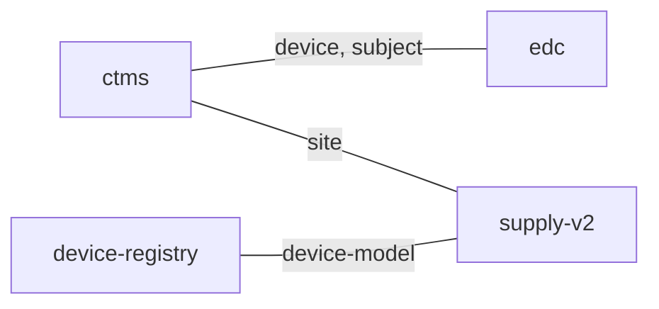

# System and concept map

Generated from approved `concepts:` entries in system notes. Shared-term links do not prove an observed data flow between systems.

| term | system | meaning | source |
|---|---|---|---|
| device | ctms | Free-text note for the delivery aid used in the study | CTMS-ARCH-v1 |
| device | edc | Yes or no flag showing whether an injection aid was used | EDC-ARCH-v1 |
| device-model | device-registry | Design version of the device | DEVICE-REGISTRY-ARCH-v1 |
| device-model | supply-v2 | Design version of the device | SUPPLY-ARCH-v2 |
| device-unit | device-registry | Physical unit with a serial number | DEVICE-REGISTRY-ARCH-v1 |
| dose-event | edc | Administered drug dose captured on the case report form | EDC-ARCH-v1 |
| kit | supply-v2 | Drug package with a randomised number | SUPPLY-ARCH-v2 |
| site | ctms | Site that takes part in a study | CTMS-ARCH-v1 |
| site | supply-v2 | Site that takes part in a study | SUPPLY-ARCH-v2 |
| study | ctms | Unique study code | CTMS-ARCH-v1 |
| subject | ctms | Enrolled participant | CTMS-ARCH-v1 |
| subject | edc | Enrolled participant | EDC-ARCH-v1 |

